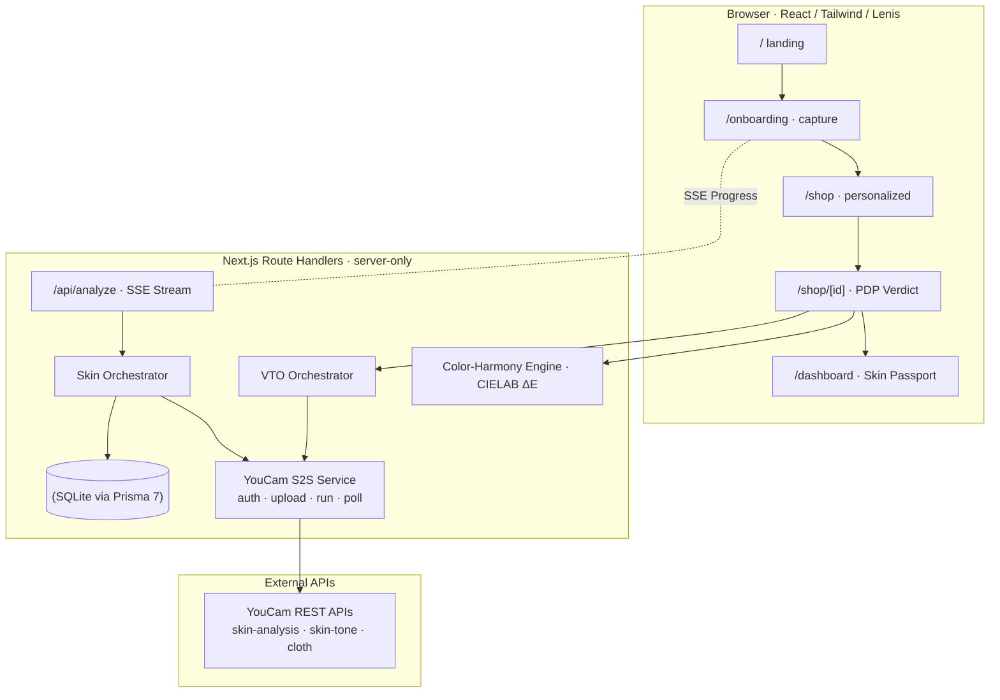

# How We Built Aura: Unifying Skin AI and Virtual Apparel Try-On Behind One Decision Engine

*Eliminating e-commerce return anxiety by combining Perfect Corp YouCam S2S REST APIs, CIELAB $\Delta E$ color science, Next.js 16, and persistent Skin Passports.*

---

⏱ **7 min read** · 💡 **Topics**: `Artificial Intelligence`, `Web Development`, `E-Commerce`, `TypeScript`, `Next.js`

---


Online retail has a multi-hundred-billion-dollar elephant in the room: **return rates**. 

Over 24% of apparel and beauty items ordered online are returned, costing global e-commerce merchants over $800 billion annually. The primary driver isn't shipping delay or defective manufacturing — it’s psychological uncertainty. Every shopper staring at an online product page asks the exact same fundamental question:

> *"Will this actually suit **me**?"*

To solve this, current e-commerce platforms either ignore the question or bolt on disjointed AI features side-by-side: a skin analyzer widget on a serum page, and a try-on widget on a coat page. These features operate in silos with zero shared context, requiring users to upload separate photos, wait for disconnected APIs, and make sense of conflicting advice.

During the **Perfect Corp. YouCam API Hackathon**, we built **Aura — The Confident-Buy Advisor** to prove a single **unification thesis**:

> **One selfie creates a persistent Skin Passport, and that Passport — not separate API calls — powers deterministic Confidence Scores across BOTH Apparel and Beauty from a single analysis.**

Here is the deep-dive engineering story of how we designed, architected, and built Aura.

---

## 1. The Core Architecture & Unification Thesis

At the heart of Aura is a single Next.js 16 application built around a zero-client-key security model. 

When a user captures a selfie on `/onboarding`, the photo is not processed piecemeal. Instead, it generates a unified **Skin Passport** combining two critical biological signals:

1. **Undertone & Tone Depth** (via YouCam `skin-tone-analysis`): Extracts $L^*a^*b^*$ coordinates, undertone classification (*Warm, Cool, Neutral*), and tone depth.
2. **Clinical Skin Concerns** (via YouCam `skin-analysis`): Scans for 8 clinical metrics (*redness, oiliness, spots, texture, dark circles, pores, wrinkles, acne*) to identify the user's #1 targeting priority.



Once saved to the anonymous session (persisted via Prisma 7 + SQLite), this single Passport drives two downstream buying verdicts through one decision engine:

- **Apparel Verdict**: Scores garment color against undertone using pure CIELAB $\Delta E$ Euclidean distance math, then renders a photorealistic Virtual Try-On via YouCam’s `cloth` S2S API.
- **Beauty Verdict**: Evaluates foundation shade proximity against undertone depth while weighting whether the formula actively targets the shopper's #1 skin concern.

Both verdicts collapse into a single unified metric:
$$\text{Confidence} = f(\text{Color Harmony} \mid \text{Shade Match}, \text{VTO Drape}, \text{Concern Targeting})$$

---

## 2. The Mathematics of Color Harmony (CIELAB $\Delta E$)

Why did we choose **CIELAB $L^*a^*b^*$ color space** over standard RGB or HSL?

RGB and HSL are device-dependent coordinate systems created for computer monitors, not human biology. Two colors with identical HSL distances can look visually harmonious on one skin tone and completely washed out on another.

CIELAB is a **perceptually uniform color space** designed to approximate human vision:
- **$L^*$**: Perceptual Lightness ($0 = \text{black}$, $100 = \text{white}$)
- **$a^*$**: Green–Red axis ($-\text{green} \leftarrow 0 \rightarrow +\text{red}$)
- **$b^*$**: Blue–Yellow axis ($-\text{blue} \leftarrow 0 \rightarrow +\text{yellow}$)

```typescript
// src/lib/color.ts
export function calculateCielabDeltaE(lab1: LAB, lab2: LAB): number {
  const dL = lab1.L - lab2.L;
  const da = lab1.a - lab2.a;
  const db = lab1.b - lab2.b;
  return Math.sqrt(dL * dL + da * da + db * db);
}
```

When evaluating a garment against a shopper's skin tone:
1. The skin undertone $L^*a^*b^*$ coordinates are retrieved from the `SkinPassport`.
2. The dominant fabric pigment $L^*a^*b^*$ coordinates are loaded from the product metadata.
3. The Euclidean distance $\Delta E$ is calculated:
   $$\Delta E = \sqrt{(L_1^* - L_2^*)^2 + (a_1^* - a_2^*)^2 + (b_1^* - b_2^*)^2}$$
4. The distance is normalized into a $0–100\%$ **Harmony Score**:
   $$\text{Harmony Score} = \max(0, \min(99, 100 - \Delta E \times 4.2))$$

If $\Delta E < 2.0$, the garment color achieves optimal contrast and visual harmony, yielding a **Buy** tier verdict (`98% Match - Warm Autumn Harmony`).

---

## 3. Server-First Security & S2S REST Architecture

A crucial architectural principle of Aura is that **API keys never leave the server**. 

All interactions with Perfect Corp's YouCam S2S REST API take place inside Next.js Route Handlers. Client components only receive sanitized, pre-scored JSON.

### The YouCam Service Layer (`src/server/youcam/`)

We quarantined all YouCam API complexity into four isolated modules:

1. **API-key auth**: Every call carries the key as a Bearer token, read only in server-side code.
2. **File upload**: Handles YouCam’s upload workflow: request an upload slot (`POST /s2s/v2.0/file`) $\rightarrow$ `PUT` binary image bytes to the signed URL.
3. **Task runner & poller**: Initiates async jobs (`POST /s2s/v2.0/task/<feature>`) and polls `/task/<feature>/<task_id>` with bounded backoff until completion, waiting out rate limits.
4. **Dual Adapter Architecture**:
   - `FixtureAdapter`: Uses pre-recorded JSON responses. Enables instant offline execution, automated testing, and zero-cost judging demos.
   - `LiveAdapter`: Connects to real YouCam REST endpoints when credentials are configured.

```typescript
// src/server/youcam/adapters/types.ts
export interface YouCamAdapter {
  analyzeSkin(imageBuffer: Buffer): Promise<SkinAnalysisResult>;
  analyzeTone(imageBuffer: Buffer): Promise<SkinToneResult>;
  renderClothVto(imageBuffer: Buffer, garmentUrl: string): Promise<ClothVtoResult>;
}
```

Because both adapters share the exact same interface, the orchestrator, scoring engine, and UI components remain completely agnostic to whether Aura is running in offline fixture mode or live mode.

---

## 4. Real-Time Client Feedback with Server-Sent Events (SSE)

Running skin analysis and tone extraction in parallel can take several seconds. To prevent UI freeze and keep shoppers engaged, we implemented lightweight **Server-Sent Events (SSE)** in Next.js Route Handlers.

Instead of traditional polling or heavy WebSocket connections, the browser subscribes to `/api/analyze/stream`:

```typescript
// src/app/api/analyze/route.ts
export async function POST(req: Request) {
  const encoder = new TextEncoder();
  const stream = new TransformStream();
  const writer = stream.writable.getWriter();

  // Async task execution with SSE status updates
  (async () => {
    await writer.write(encoder.encode(`data: ${JSON.stringify({ step: 'UPLOADING', progress: 20 })}\n\n`));
    const tone = await youcam.analyzeTone(buffer);
    
    await writer.write(encoder.encode(`data: ${JSON.stringify({ step: 'EXTRACTING_UNDERTONE', progress: 50 })}\n\n`));
    const concerns = await youcam.analyzeSkin(buffer);

    await writer.write(encoder.encode(`data: ${JSON.stringify({ step: 'SAVING_PASSPORT', progress: 90 })}\n\n`));
    const passport = await savePassport({ tone, concerns });

    await writer.write(encoder.encode(`data: ${JSON.stringify({ step: 'COMPLETE', passport })}\n\n`));
    await writer.close();
  })();

  return new Response(stream.readable, {
    headers: {
      'Content-Type': 'text/event-stream',
      'Cache-Control': 'no-cache',
      'Connection': 'keep-alive',
    },
  });
}
```

The client UI renders a live progress bar with dynamic stage labels ("Reading undertone... Scoring concerns..."), creating a silky, high-tech onboarding experience.

---

## 5. UI/UX Design: Dark Glassmorphism, Lenis & Parallax

Great AI decision engines deserve exceptional design. We built Aura's landing page and storefront with a dark obsidian aesthetic (`#05050A`) accented by glowing rose gold (`#F43F5E`), violet (`#A855F7`), and cyan (`#06B6D4`) radial backlights.

### Key Visual & Interactive Features
- **Lenis Smooth Scroll Engine**: Integrated Lenis scroll lifecycle for momentum-based scrolling across all landing sections.
- **Interactive Canvas Backdrop**: A custom HTML5 Canvas renders animated glowing light orbs and particle node networks that react to mouse movements.
- **Magnetic Buttons**: Custom `Magnetic.tsx` wrapper that pulls interactive buttons toward the user's cursor on hover.
- **Live Skin Passport Simulator**: Allows visitors to test skin undertones (*Warm Golden, Cool Rosy, Neutral Olive, Rich Deep*) live on screen, seeing real-time CIELAB $\Delta E$ scores recalculate instantly.
- **Before/After VTO Split Slider**: An interactive dual-layer comparison slider revealing YouCam photorealistic cloth drape and lighting adaptation.

---

## 6. Testing Strategy & Production Quality

We applied Test-Driven Development (TDD) throughout the project build:

- **Vitest**: 38 unit, contract, and integration tests verifying color conversions, scoring logic, YouCam auth token caching, and Prisma repository operations.
- **Playwright**: 9 automated end-to-end user journey tests validating full camera capture $\rightarrow$ SSE stream $\rightarrow$ shop personalization $\rightarrow$ cart checkout.
- **TypeScript Strict Mode**: Zero compilation errors (`pnpm tsc --noEmit`).

```bash
# Running the complete test suite
pnpm test

# Running end-to-end user journey tests
pnpm exec playwright test
```

Result: **47/47 tests passing**.

---

## 7. What's Next for Aura

Aura P0 delivers a fully functional, zero-guesswork decision engine. Looking forward, our roadmap includes:

1. **P1 Advisor Agent**: Integrating Groq (GPT-OSS 120B) with OpenAI as fallback to provide natural language styling advice ("Why does this Emerald coat complement my undertone?").
2. **Shopify Embeddable Extension**: Packaging Aura into a turnkey Shopify App for merchants to install on existing storefronts.
3. **Multi-Garment Outfit Layering**: Extending YouCam's `cloth` API integration to render complete layered outfits (top + pants + outerwear) simultaneously.

---

## Conclusion & Links

Aura proves that when skin AI, tone analysis, and Virtual Try-On share a single unified context, e-commerce shopping transforms from guesswork into confidence.

- 📦 **GitHub Repository**: [github.com/rohanjain1648/Aura-The-Confident-Buy-Advisor](https://github.com/rohanjain1648/Aura-The-Confident-Buy-Advisor)
- 🚀 **Live Demo**: [aura-confident-buy.vercel.app](https://aura-confident-buy.vercel.app)
- 🏆 **Hackathon Track**: Perfect Corp YouCam API Hackathon (Combined Track)

---

### **Enjoyed this article?**
If you found this technical deep-dive helpful:
- 👏 **Give it 50 claps on Medium!**
- 🌟 **Star the repository on GitHub**: [rohanjain1648/Aura-The-Confident-Buy-Advisor](https://github.com/rohanjain1648/Aura-The-Confident-Buy-Advisor)
- 💬 **Leave a comment below** with your thoughts on CIELAB color harmony and unified e-commerce AI decision engines!
