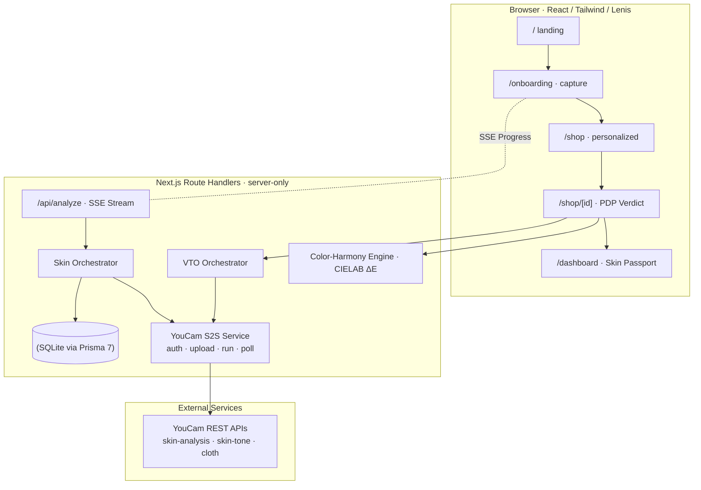

# Devpost Submission — Aura: The Confident-Buy Advisor

> **Track**: Perfect Corp. YouCam API Hackathon — Combined Skin AI + Apparel VTO Track  
> **Tagline**: One selfie. Two verdicts. Zero guesswork.  
> **Repository**: [github.com/rohanjain1648/Aura-The-Confident-Buy-Advisor](https://github.com/rohanjain1648/Aura-The-Confident-Buy-Advisor)  
> **Demo URL**: [aura-confident-buy.vercel.app](https://aura-confident-buy.vercel.app) *(or local `pnpm dev` on http://localhost:3000)*  

---

## 1. Project Overview & Elevator Pitch

Online shoppers continuously ask one core question before clicking "Buy": **"Will this actually suit ME?"**

Current e-commerce platforms either ignore this question or bolt on disjointed, generic AI widgets side-by-side: a skin analyzer on a moisturizer page and a try-on widget on a dress page, operating with zero shared context.

**Aura — The Confident-Buy Advisor** breaks this silo through a single **unification thesis**:
**One selfie creates a persistent Skin Passport**, and that Passport — not separate API calls — powers deterministic, personalized **Confidence Scores** across **both Apparel** (color harmony + virtual fitting) and **Beauty** (shade match + concern targeting) from a single analysis.

---

## 2. What It Does

Aura transforms online shopping into a guided, high-confidence experience:

1. **Selfie Capture & Passport Generation** (`/onboarding`):
   - Shoppers upload or take a selfie. Pre-flight checks validate image quality (resolution, face presence, lighting) *before* consuming API credits.
   - The photo is fanned out to YouCam's `skin-tone-analysis` (undertone & CIELAB coordinates) and `skin-analysis` (8 clinical concerns).
   - Real-time progress streams to the browser via **Server-Sent Events (SSE)** ("Uploading… Reading undertone… Scoring concerns…").
   - The results normalize into a persistent **Skin Passport** stored in an anonymous session.

2. **Personalized Storefront Browsing** (`/shop`):
   - Every product card instantly displays a personalized **Match Badge** computed from the stored Passport (`98% Match - Warm Autumn Harmony` or `96% Match - Targets Redness`).
   - Catalog items auto-sort by verdict tier: **Buy** (Green), **Maybe** (Amber), or **Skip** (Slate).

3. **PDP Verdict & Virtual Try-On** (`/shop/[id]`):
   - **Apparel**: Evaluates garment color against skin undertone using pure CIELAB ΔE distance math, then renders a photorealistic Virtual Try-On via YouCam's `cloth` S2S REST API.
   - **Beauty**: Evaluates foundation/makeup shade proximity against undertone depth while weighting whether the product actively targets the user's #1 skin concern.

4. **Look History & Dashboard** (`/dashboard`, `/cart`):
   - Shoppers review past verdicts, saved VTO looks, and complete confident checkout without return anxiety.

---

## 3. How We Built It

### Tech Stack
- **Framework**: Next.js 16 (App Router), TypeScript (Strict Mode)
- **UI & Styling**: Tailwind CSS v4, shadcn/ui, Lenis Smooth Scroll Engine, Lucide Icons, Glassmorphism design system
- **Data & Database**: Prisma 7 ORM with `@prisma/adapter-better-sqlite3` driver adapter & SQLite
- **YouCam APIs**: YouCam S2S REST API (`skin-analysis`, `skin-tone-analysis`, `cloth` VTO)
- **Color Science Engine**: Pure TypeScript CIELAB ΔE Euclidean color-harmony engine
- **Testing**: Vitest (Unit/Contract/Integration) + Playwright (E2E User Journey)

### Key Architectural Highlights



1. **Zero Client Key Exposure**: The YouCam API key exists exclusively inside server-side Route Handlers. Client components only see sanitized, pre-scored JSON.
2. **Dual-Mode Adapter Pattern**:
   - `fixture` mode: Runs with offline pre-recorded API responses for instant testing and zero-cost judging demos.
   - `live` mode: Connects to the YouCam v2.0 REST API with API-key auth, signed uploads, and task polling with bounded backoff.
3. **Pure CIELAB Color Engine**: Converts RGB/Hex pigments into 3D L*a*b* space to compute Euclidean color distance (ΔE), mapping skin undertone hues to seasonal garment harmony palettes.

---

## 4. Challenges We Ran Into

1. **Quarantining API Surface Variations**:
   - YouCam documentation spans multiple client SDKs and REST endpoints. We built a unified server module (`src/server/youcam/`) isolating token auth, file uploads, and task polling so the rest of the application remains pristine.
2. **Real-Time Client Feedback Without Blocking**:
   - Running skin analysis and tone extraction in parallel required streaming status updates to the browser. We implemented lightweight Server-Sent Events (SSE) in Next.js Route Handlers to push streaming updates seamlessly.
3. **Next.js 16 Middleware Runtime**:
   - Next.js 16 defaults middleware to the Edge runtime. Because Prisma + SQLite requires Node.js filesystem access, we explicitly configured `export const config = { runtime: 'nodejs' }` in `middleware.ts` to ensure session persistence across all requests.

---

## 5. Accomplishments We're Proud Of

- 🧪 **47/47 Tests Passing**: 38 unit, integration, and contract tests in Vitest + 9 E2E user journey tests in Playwright.
- ⚡ **Zero Guesswork Engine**: Pure mathematical color harmony and clinical concern targeting collapsing 3 YouCam APIs into one unified score.
- 💎 **Premium UI/UX**: Dark obsidian glassmorphic design, Lenis momentum smooth scrolling, interactive Skin Passport simulator, and split-screen VTO slider.
- 🔒 **Server-First Security**: 100% server-isolated API secret handling.

---

## 6. What We Learned

- **Color Science & Perceptual Psychology**: How CIELAB L*a*b* color space provides far more accurate clothing recommendations than basic RGB/HSL matching.
- **Reading Raw Skin Data**: Turning YouCam's health scores and skin colour into ranked concerns, undertone, and depth.
- **Unified E-Commerce Architecture**: Proving that skin AI and apparel VTO are significantly more powerful when sharing a single user passport context.

---

## 7. What's Next for Aura (Roadmap)

- **P1 Advisor Agent**: Integrate Groq (GPT-OSS 120B) with OpenAI as fallback to provide natural language styling advice ("Why does this Emerald coat complement my undertone?").
- **Shopify & Commerce Layer Integration**: Package Aura as an embeddable Shopify App extension for merchant storefronts.
- **Multi-Garment Outfit Layering**: Support simultaneous outfit try-ons (top + bottom + outerwear) powered by YouCam's multi-cloth pipeline.

---

## 8. Deliverables & Verification Commands

### Source Code & Repositories
- **GitHub Repository**: [https://github.com/rohanjain1648/Aura-The-Confident-Buy-Advisor](https://github.com/rohanjain1648/Aura-The-Confident-Buy-Advisor)

### Local Verification Steps
```bash
# 1. Install dependencies
pnpm install

# 2. Database migrations & catalog seed
pnpm prisma migrate dev
pnpm prisma db seed

# 3. Execute all unit, contract, and integration tests
pnpm test

# 4. Start local server
pnpm dev
# Open http://localhost:3000

# 5. Run end-to-end user journey tests
pnpm exec playwright test
```
