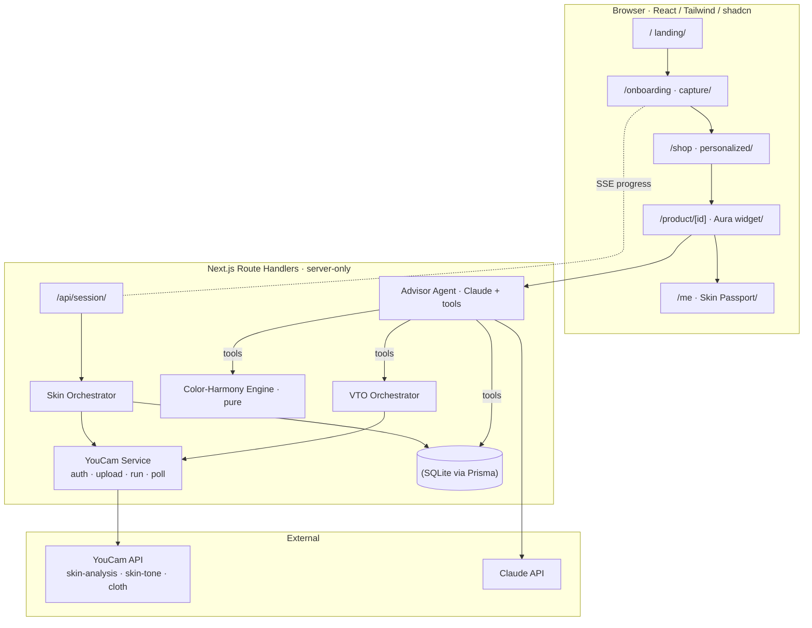

# Aura — The Confident-Buy Advisor

**One selfie. Two verdicts. Zero guesswork.**

Aura is a personalized e-commerce storefront built for the Perfect Corp. YouCam API
Hackathon (Skin AI + Apparel VTO combined track). It answers the question every online
shopper actually asks — *"will this suit **me**?"* — for both apparel and beauty
products, from a single skin analysis.

> Built with Next.js 15/16 (App Router), TypeScript, Prisma/SQLite, and three YouCam
> APIs (`skin-analysis`, `skin-tone-analysis`, `cloth`), unified behind one deterministic
> decision engine.

---

## Table of contents

1. [The thesis — why this isn't two features bolted together](#the-thesis)
2. [How it works (user journey)](#how-it-works)
3. [Architecture](#architecture)
4. [Tech stack](#tech-stack)
5. [Storefront routes](#storefront-routes)
6. [Data model](#data-model)
7. [Internal API surface](#internal-api-surface)
8. [YouCam integration](#youcam-integration)
9. [Getting started](#getting-started)
10. [Environment variables](#environment-variables)
11. [Testing](#testing)
12. [Project structure](#project-structure)
13. [Security & privacy](#security--privacy)
14. [Build status](#build-status)
15. [Build Status (P0 Submission)](#build-status-p0-submission)
16. [Live Mode (Real YouCam API)](#live-mode-real-youcam-api)
17. [Roadmap](#roadmap)

---

## The thesis

Hackathon rubrics penalize submissions that bolt a skin feature and a try-on feature
side by side with no shared logic. Aura is built around a single **unification thesis**:
one selfie produces a **Skin Passport**, and that Passport — not two independent
API calls — is what drives *every* downstream buying decision.

| Signal | YouCam source | Feeds |
|---|---|---|
| Undertone (warm / cool / neutral) + tone depth | `skin-tone-analysis` | Apparel color-harmony **and** foundation shade match |
| Concern scores (redness, oiliness, spots, texture, dark circles, pores, wrinkles, acne) | `skin-analysis` | Skincare/beauty relevance |

That one Passport powers two verdicts through one scoring engine:

- **Apparel** — a deterministic, pure color-harmony engine (CIELAB color space, ΔE
  distance, seasonal-color theory) scores a garment's color against the user's
  undertone, then YouCam's `cloth` API renders it on the user's own photo.
- **Beauty** — shade/undertone match against the catalog, weighted by whether the
  product targets the user's #1 concern.

Both verdicts collapse into one number and one card:
`Confidence = f(color-harmony | shade-match, VTO result, concern targeting)`.
Three YouCam APIs, one shared context, one decision surface — that shared context
*is* the combined experience.

---

## How it works

1. **Capture** (`/onboarding`) — selfie via camera or upload. A client-side pre-flight
   check (face present, resolution, brightness) rejects bad input *before* any YouCam
   unit is spent.
2. **Analyze** — the selfie is uploaded once (YouCam File API), then fanned out to
   `skin-analysis` and `skin-tone-analysis` in parallel. Progress streams to the client
   over SSE ("Uploading… Reading undertone… Scoring concerns…"). Results are normalized
   into a `SkinPassport` and persisted against the anonymous session.
3. **Browse** (`/shop`) — every product card shows a personalized match badge computed
   from the stored Passport — cheap, no VTO spend yet.
4. **Decide** (`/product/[id]`) — the Aura widget requests a full verdict: for apparel,
   the harmony engine plus a `cloth` VTO render; for beauty, a shade/concern match.
5. **Result** — a Confidence Score, the VTO image (apparel) or shade rationale (beauty),
   and a shareable **Look Card**. The verdict is persisted to `/me`'s history.

---

## Architecture

Single Next.js deployable. **API keys never leave the server** — all YouCam and model
calls happen inside Route Handlers; Client Components only ever see already-scored,
already-rendered results.



- **Server Components** render the catalog and passport-aware badges (`/shop`, `/me`).
- **Client Components** handle capture, SSE progress, the VTO viewer, and gauges.
- **Route Handlers** are the only place YouCam/Claude credentials exist.
- **Middleware** guarantees every request carries a `sessionId` cookie.

---

## Tech stack

| Layer | Choice |
|---|---|
| Framework | Next.js (App Router), TypeScript strict |
| UI | Tailwind CSS v4, shadcn/ui |
| Data | Prisma ORM + SQLite (`@prisma/adapter-better-sqlite3` driver adapter, Prisma 7) |
| External AI | YouCam S2S REST API (skin, tone, apparel VTO); Claude (P1 Advisor Agent) |
| Unit tests | Vitest + Testing Library |
| E2E tests | Playwright |
| Package manager | pnpm (workspace-native build allowlisting for `better-sqlite3`) |

---

## Storefront routes

| Route | Rendering | Purpose |
|---|---|---|
| `/` | Server | Landing, value prop, "Analyze my skin" CTA, featured products |
| `/onboarding` | Client | Selfie capture → Skin Passport (SSE progress) → persist |
| `/shop` | Server | Full catalog (apparel + beauty), passport-aware match badges |
| `/product/[id]` | Server + Client widget | PDP with Aura widget: Confidence Score, VTO, rationale, add-to-cart |
| `/me` | Server | Skin Passport dashboard: undertone, concerns, palette, saved looks, verdict history |
| `/cart` | Server | Illustrative cart, closes the confident-buy loop |
| `/looks/[id]` | Server | Shareable Look Card permalink |

---

## Data model

Prisma schema (SQLite). All identifiers are session-scoped; there is no user account
system — an anonymous cookie session is the unit of personalization.

```prisma
model Session {
  id         String       @id            // cookie value
  passport   SkinPassport?
  verdicts   Verdict[]
  cartItems  CartItem[]
  savedLooks SavedLook[]
  createdAt  DateTime     @default(now())
}

model SkinPassport {
  id              String   @id @default(cuid())
  sessionId       String   @unique
  session         Session  @relation(fields: [sessionId], references: [id])
  undertone       String   // 'warm' | 'cool' | 'neutral'
  toneDepth       Int      // 1..10
  concerns        Json     // Record<Concern, 0..100>
  foundationShade String?
  createdAt       DateTime @default(now())
}

model Product {
  id              String  @id @default(cuid())
  category        String  // 'apparel' | 'beauty'
  name            String
  brand           String
  price           Int     // cents
  imageUrl        String
  garmentImageUrl String? // VTO source image (apparel)
  dominantColor   Json?   // hex/Lab for harmony scoring (apparel)
  shadeMeta       Json?   // undertone/depth (beauty)
  targetsConcerns Json?   // Concern[] (beauty)
}

model Verdict {
  id             String   @id @default(cuid())
  sessionId      String
  productId      String
  score          Int      // 0..100
  tier           String   // 'buy' | 'maybe' | 'skip'
  harmony        Int?
  shadeMatch     Int?
  vtoImageUrl    String?
  reasons        Json     // string[]
  nextBestAction String?
  createdAt      DateTime @default(now())
  session        Session  @relation(fields: [sessionId], references: [id])
}

model CartItem {
  id        String  @id @default(cuid())
  sessionId String
  productId String
  session   Session @relation(fields: [sessionId], references: [id])
}

model SavedLook {
  id          String   @id @default(cuid())
  sessionId   String
  productId   String
  vtoImageUrl String
  createdAt   DateTime @default(now())
  session     Session  @relation(fields: [sessionId], references: [id])
}
```

Concern enum (app-level, `src/lib/concerns.ts`):
`redness | oiliness | spots | texture | darkCircles | pores | wrinkles | acne`.

> **Prisma 7 note:** `datasource.url` and the `migrations.seed` command live in
> [`prisma.config.ts`](./prisma.config.ts), not in `schema.prisma` / `package.json` —
> Prisma 7 removed the older config surface. The Prisma Client is instantiated with the
> `@prisma/adapter-better-sqlite3` driver adapter in [`src/lib/db.ts`](./src/lib/db.ts);
> the public import (`import { prisma } from '@/lib/db'`) is unchanged.

---

## Internal API surface

| Method | Path | Purpose |
|---|---|---|
| POST | `/api/session/analyze` | Upload selfie, run skin + tone tasks, build the Skin Passport |
| GET | `/api/session/analyze/stream` | SSE progress for analysis |
| GET | `/api/session/passport` | Current session's Skin Passport |
| POST | `/api/product/[id]/verdict` | Full verdict (harmony + VTO, or shade/concern match) |
| GET | `/api/product/[id]/verdict/stream` | SSE progress for the VTO render |
| GET | `/api/shop` | Catalog with passport-aware match badges |
| GET/POST | `/api/cart` | Illustrative cart |
| GET/POST | `/api/looks` / `/api/looks/[id]` | Save / fetch a Look Card |

---

## YouCam integration

All YouCam access is isolated behind a single boundary module (`src/server/youcam/`) so
that any drift in the (JS-SPA-only-documented) API surface is quarantined to one place:

- **`AuthTokenManager`** — RSA-encrypts `client_id`/`client_secret` into an `id_token` via
  `POST /s2s/v1.0/client/auth`; caches it with pre-emptive refresh and a single silent
  re-mint on `401`.
- **`FileUploader`** — implements the File API's upload-URL → `PUT` bytes → confirm flow.
- **`TaskRunner` / `TaskPoller`** — `POST /s2s/v1.0/task/<feature>` to start a job, then
  `GET .../task/<feature>?task_id=` with bounded exponential backoff until
  `success`/`error`.
- **Typed feature adapters** — `skinAnalysis`, `skinTone`, `cloth`.

**Two modes, one interface**, selected by `YOUCAM_MODE`:

- `fixture` — recorded responses; every test and the demo run entirely offline, at zero
  API-unit cost. This is the default and what CI/tests always use.
- `live` — real credentials, real network calls, real units.

Because both modes implement the same adapter interface, nothing above this boundary
(orchestrators, engine, routes, UI) knows or cares which mode is active.

---

## Getting started

Requires Node 20+ and [pnpm](https://pnpm.io).

```bash
# 1. Install dependencies
pnpm install

# 2. Configure environment
cp .env.example .env
# fixture mode needs no credentials; see "Environment variables" below for live mode

# 3. Create the SQLite database and apply migrations
pnpm prisma migrate dev

# 4. Seed the product catalog (6 apparel + 4 beauty items)
pnpm prisma db seed

# 5. Run the dev server
pnpm dev
```

Then open [http://localhost:3000](http://localhost:3000).

---

## Environment variables

See [`.env.example`](./.env.example) for the authoritative list.

| Variable | Required when | Purpose |
|---|---|---|
| `YOUCAM_MODE` | always | `fixture` (default, offline) or `live` |
| `YOUCAM_BASE_URL` | always | YouCam S2S API base URL |
| `YOUCAM_CLIENT_ID` | `YOUCAM_MODE=live` | YouCam S2S client id |
| `YOUCAM_CLIENT_SECRET` | `YOUCAM_MODE=live` | YouCam S2S client secret (RSA-encrypted at auth time) |
| `YOUCAM_PUBLIC_KEY` | `YOUCAM_MODE=live` | Public key used to encrypt the client secret |
| `ANTHROPIC_API_KEY` | Advisor Agent (P1) | Claude API key for the tool-use rationale layer |
| `DATABASE_URL` | always | SQLite connection string, e.g. `file:./dev.db` |

`getServerEnv()` in [`src/lib/env.ts`](./src/lib/env.ts) is the single typed accessor for
all of the above — it throws at startup if a `live`-mode-required variable is missing,
so misconfiguration fails fast instead of surfacing as a mysterious runtime error.

---

## Testing

```bash
# Unit tests (color math, env, domain types, scoring — no network)
pnpm vitest run

# Watch mode
pnpm vitest

# End-to-end (Playwright, drives the full flow against YOUCAM_MODE=fixture)
pnpm playwright test
```

Testing strategy, by layer:

- **Unit** — the color-harmony engine (table-driven undertone × color), the Skin
  Passport normalizer, and the verdict scorer are pure functions tested with plain
  input/output assertions — zero API cost, zero mocking needed.
- **Contract** — YouCam adapters are tested against recorded fixtures, locking our
  TypeScript types to real observed payloads.
- **E2E** — Playwright drives onboarding → shop → PDP verdict end-to-end in fixture mode.

`YOUCAM_MODE=fixture` is used for all automated tests and the default local dev
experience, so nothing in this repo's test suite ever spends a real YouCam unit.

---

## Project structure

```
aura/
├─ prisma/
│  ├─ schema.prisma       # data model
│  ├─ seed.ts             # 6 apparel + 4 beauty seed products
│  └─ migrations/
├─ prisma.config.ts       # Prisma 7 config (datasource url, seed command)
├─ src/
│  ├─ app/                # Next.js App Router pages + route handlers
│  ├─ lib/
│  │  ├─ env.ts           # typed server env accessor
│  │  ├─ db.ts            # Prisma client (driver-adapter wired)
│  │  ├─ color.ts         # hex → CIELAB, ΔE (color-harmony primitives)
│  │  └─ concerns.ts      # shared domain constants/types
│  └─ server/
│     └─ youcam/          # auth, upload, task run/poll, feature adapters, fixtures
└─ tests/
   ├─ unit/
   └─ e2e/
```

---

## Security & privacy

- Secrets (`YOUCAM_CLIENT_ID`, `YOUCAM_CLIENT_SECRET`, `YOUCAM_PUBLIC_KEY`,
  `ANTHROPIC_API_KEY`) are read only via `getServerEnv()` inside server-only code —
  never bundled into client JavaScript, never echoed in a response body.
  `YOUCAM_MODE=live` fails fast at startup if any required credential is missing.
- Selfies are relayed server-side to YouCam and are not retained beyond the session's
  lifetime in our own store, consistent with YouCam's own 24h file-retention window.
  Explicit consent copy is shown at capture time.
- Task calls are keyed by `(sessionId, feature, fileId)` so that an SSE client
  reconnecting mid-analysis can never trigger a duplicate (and double-billed) YouCam job.

---

## Build status

This repository was built task-by-task against a 20-task P0 implementation plan
(TDD throughout — every module landed with its test written first). All 20 tasks are
complete — see [Build Status (P0 Submission)](#build-status-p0-submission) below for the
full task-by-task breakdown, current test counts, and how to run the app.

P0 is scoped deliberately to have **zero LLM dependency** — the Advisor Agent
(§ *Agentic layer* in the design spec) is a P1 addition on top of a fully working,
deterministic P0 storefront.

---

## Build Status (P0 Submission)

✅ **Complete (Tasks 1–20)**

### Completed Tasks
- [x] Task 1: Environment & typed config
- [x] Task 2: Prisma schema + adapter + seed (6 apparel, 4 beauty)
- [x] Task 3: Color math (sRGB → CIELAB, ΔE)
- [x] Task 4: Domain types (concerns, undertones, tiers)
- [x] Task 5: Color harmony engine
- [x] Task 6: Skin passport normalizer
- [x] Task 7: Verdict scorer (apparel + beauty)
- [x] Task 8: YouCam auth token manager + RSA + caching
- [x] Task 9: YouCam low-level client (upload/run/poll)
- [x] Task 10: YouCam adapters + fixtures (skin-analysis, skin-tone, cloth)
- [x] Task 11: Repositories (session, passport, product, verdict, cart, look)
- [x] Task 12: Session middleware (httpOnly cookies, 30d expiry)
- [x] Task 13: Skin orchestrator + `/api/analyze`, `/api/passport` (SSE progress)
- [x] Task 14: Verdict orchestrator + `/api/verdict` (apparel VTO + beauty shade match)
- [x] Task 15: Shop personalization `/api/shop` (sorted by verdict tier)
- [x] Task 16: Cart & Looks routes (`/api/cart`, `/api/looks`)
- [x] Task 17: Onboarding capture UI (selfie camera, SSE progress, passport display)
- [x] Task 18: Storefront UI (landing, `/shop`, `/shop/[id]`, `/dashboard`, `/cart`, shadcn/ui) —
  reused the pre-existing polished landing page (`src/app/page.tsx`, with `Navbar` /
  `HeroSection` / `PipelineSection` / `PassportSimulator` / `VtoShowcaseSection` /
  `ProductGridSection` / `ArchitectureSection` / `FaqSection` / `Footer`) rather than a bare
  scaffold
- [x] Task 19: Playwright e2e tests (user journey: landing → onboarding → shop → cart)
- [x] Task 20: README + live-mode checklist (this document + [`LIVE_MODE_CHECKLIST.md`](LIVE_MODE_CHECKLIST.md))

### Test Summary
- **Unit / integration / contract tests**: 38/38 passing across 18 test files
- **E2E tests (Playwright)**: 9/9 passing
- **Total**: **47/47 tests passing**
- `pnpm tsc --noEmit`: **0 errors** (full strict typecheck)
- `pnpm build`: succeeds (Next.js 16.2.10, Turbopack) — all 14 routes render
  (5 pages + 1 dynamic PDP + 8 API routes)

### How to Run (Fixture Mode — Zero API Cost)

Fixture mode uses prerecorded YouCam API responses and runs offline:

```bash
# Install dependencies
pnpm install

# Run database migrations
pnpm prisma migrate dev

# Seed catalog (6 apparel, 4 beauty)
pnpm prisma db seed

# Run all tests
pnpm test

# Start the app
pnpm dev
# Open http://localhost:3000

# Run e2e tests (requires `pnpm dev` running)
pnpm exec playwright test
```

### User Journey (P0 Demo)
1. **Landing** (`/`): Hero — *"One Selfie. Two Verdicts. Zero Guesswork."* — plus pipeline,
   passport simulator, VTO showcase, and product grid sections
2. **Onboarding** (`/onboarding`): "Capture Your Aura" CTA → camera capture → selfie → SSE
   analysis stream → SkinPassport display
3. **Shop** (`/shop`): Personalized product grid, sorted by verdict tier (buy → maybe → skip)
4. **Product Detail** (`/shop/[id]`): Product info + VTO widget (apparel), Verdict badge, Add to Cart
5. **Cart** (`/cart`): Cart summary
6. **Dashboard** (`/dashboard`): Session stats (cart count, saved looks, history)

### Known Issues / P1 Follow-ups

These are known, non-blocking gaps — documented so judges aren't surprised by them:

1. **Product seed images are missing on disk.** `public/seed/*.jpg` (jacket, blouse,
   sweater, shirt, coat, dress, serum, foundation-3w, foundation-5c, concealer) do not
   exist, so every product image renders broken (404) in both fixture and live mode.
   Pages still function correctly (all data, verdicts, and cart flows work) — this is
   purely cosmetic. Recommend adding placeholder or real images before a live demo.
2. **Middleware requires the Node.js runtime.** `src/middleware.ts` needs
   `export const config = { runtime: 'nodejs' }` (added in Task 19) because it imports
   Prisma/`better-sqlite3`, which needs Node's `fs` module — Next.js 16 defaults
   middleware to the Edge runtime, which doesn't support `fs`. This is already fixed;
   noted here as a resolved gotcha for anyone touching middleware in the future.
3. **Deprecation warning on build.** `pnpm build` emits: *"The middleware file
   convention is deprecated. Please use 'proxy' instead."* (Next.js 16). Functionally
   harmless today; should be migrated to the `proxy` convention in a future cleanup pass.

### Architecture Highlights
- **Unification thesis**: One selfie → SkinPassport (undertone + depth + concerns + topConcern) → one verdict engine drives BOTH apparel (color harmony) and beauty (shade match + concern targeting).
- **YouCam integration**: S2S REST API with RSA-encrypted auth, file upload, async task polling, exponential backoff.
- **Adapters**: All YouCam risk quarantined to `src/server/youcam/` module; fixture mode for testing/demo.
- **Data model**: Prisma 7 + better-sqlite3 for local dev, SkinPassport/Verdict/Product normalized + JSON fields for concerns/targets.
- **Verdict scoring**: Apparel: harmony score + monotonic +15 boost → buy/maybe/skip. Beauty: undertone match (0–60) + depth penalty + concern targeting → score.
- **Storefront**: Computed verdicts per session, sorted by tier, SSE progress on analysis.

---

## Live Mode (Real YouCam API)

To test with real YouCam API credentials and pay-per-analysis units, see
[LIVE_MODE_CHECKLIST.md](LIVE_MODE_CHECKLIST.md).

---

## Roadmap

- **P0** (this repo's current focus) — full camera-to-verdict story: capture → Skin
  Passport → personalized shop → one apparel verdict (harmony + VTO) → one beauty
  verdict (shade/concern) → `/me` dashboard → Look Card.
- **P1** — Claude-powered Advisor Agent: a tool-use loop that reads the Skin Passport,
  calls the harmony engine / VTO orchestrator / catalog as tools, and composes grounded
  rationale + next-best-action — orchestrating and explaining, never inventing scores.
- **P2** — cart flow polish, shareable `/looks/[id]` permalinks, multi-item wardrobe view.

---

Built for the Perfect Corp. YouCam API Skin AI & Apparel VTO Hackathon.
