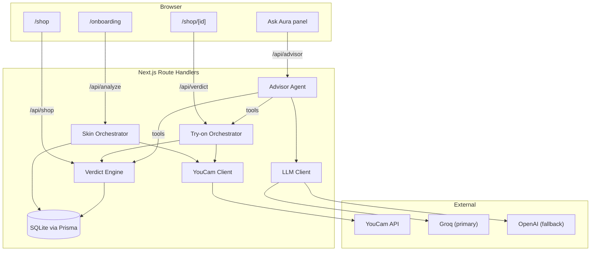

# Aura — The Confident-Buy Advisor

**One selfie. Two verdicts. Zero guesswork.**

Aura is a personalized storefront built for Perfect Corp.'s YouCam API Skin AI & eCommerce
VTO Hackathon. It answers the question every online shopper actually asks — *"will this
suit **me**?"* — for both apparel and beauty products, from a single selfie.

> Built with Next.js 16 (App Router), TypeScript, and Prisma/SQLite. It uses three YouCam
> APIs (`skin-analysis`, `skin-tone-analysis`, `cloth-v4`), one deterministic decision
> engine, and a tool-calling advisor agent on Groq and OpenAI.

---

## Table of contents

1. [The thesis](#the-thesis)
2. [How it works](#how-it-works)
3. [Built during the submission period](#built-during-the-submission-period)
4. [Architecture](#architecture)
5. [Tech stack](#tech-stack)
6. [Storefront routes](#storefront-routes)
7. [Data model](#data-model)
8. [Internal API surface](#internal-api-surface)
9. [YouCam integration](#youcam-integration)
10. [Advisor Agent](#advisor-agent)
11. [Getting started](#getting-started)
12. [Environment variables](#environment-variables)
13. [Deployment](#deployment)
14. [Testing](#testing)
15. [Project structure](#project-structure)
16. [Security & privacy](#security--privacy)
17. [Known limitations](#known-limitations)
18. [Roadmap](#roadmap)
19. [License](#license)

---

## The thesis

Skin advice and virtual try-on usually live in separate tools, so shoppers still have to
work out what the results mean for a purchase. Aura is built around a single idea: one
selfie produces a **Skin Passport**, and that Passport drives *every* downstream buying
decision.

| Signal | YouCam source | Feeds |
|---|---|---|
| Undertone (warm / cool / neutral) + tone depth, derived from the returned skin colour | `skin-tone-analysis` | Apparel color harmony **and** foundation shade match |
| Concern scores (redness, oiliness, spots, texture, dark circles, pores, wrinkles, acne) | `skin-analysis` | Beauty product relevance |

That one Passport powers two verdicts through one scoring engine:

- **Apparel** — a deterministic color-harmony engine scores a garment's color against the
  shopper's undertone using CIELAB distance. YouCam's `cloth-v4` API then renders the
  garment on the shopper's own photo.
- **Beauty** — a shade and undertone match against the catalog, weighted by whether the
  product targets the shopper's top concern.

Both produce a 0–100 score and a tier: `buy` (70+), `maybe` (45–69), or `skip` (below 45).

---

## How it works

1. **Capture** (`/onboarding`) — take a selfie with the on-screen face guide, or upload a
   photo. Photos under 480 px on the short side are rejected in the browser, before any
   YouCam unit is spent.
2. **Analyze** — the face crop is uploaded and sent to `skin-analysis` and
   `skin-tone-analysis` in parallel, while the wider frame is stored for try-on. Results are
   normalized into a `SkinPassport` and saved against the anonymous session. Photo problems,
   such as a face that's too small or a dark image, come back as guidance the shopper can
   act on.
3. **Browse** (`/shop`) — every product card shows a personalized verdict from the stored
   Passport, best matches first. This spends no API units.
4. **Decide** (`/shop/[id]`) — see the verdict and generate a real try-on for apparel.
5. **Ask** — the **Ask Aura** panel on the shop and product pages explains verdicts, suggests
   what to buy, and can run a try-on on request.

---

## Built during the submission period

Aura began as a prototype in August 2026 that ran only on prerecorded data. Its real API
integration had never run successfully. The tag
[`pre-hackathon-baseline`](https://github.com/rohanjain1648/Aura-The-Confident-Buy-Advisor/tree/pre-hackathon-baseline)
marks that state, and [this comparison](https://github.com/rohanjain1648/Aura-The-Confident-Buy-Advisor/compare/pre-hackathon-baseline...main)
shows everything since.

Added after the submission period began on Sep 29, 2026:

- **Working YouCam integration** — rebuilt on the v2.0 API with API-key auth, and run against
  the live API with real photos: skin analysis, skin tone, and clothes try-on.
- **Skin data interpretation** — health scores become ranked concerns, and undertone and
  depth are derived from the returned skin colour.
- **Advisor Agent** — a tool-calling shopping advisor on Groq, with OpenAI as fallback.
- **End-to-end flow fixes** — session handling, passport saving, stored photos for try-on,
  and clear errors, none of which worked with real users before.
- **Capture experience** — a face guide, a crop that meets YouCam's limits, and photo upload.
- **Real catalog** — product photos, with garment colours matched to them.
- **Deployment** — a Render Blueprint.

---

## Architecture

Single Next.js deployable. **API keys never leave the server** — all YouCam and model calls
happen inside Route Handlers, and the browser only sees scored results.



- **Pages** are client components that call the Route Handlers. The landing page presents
  the concept and links into the live flow.
- **Route Handlers** are the only place YouCam, Groq, and OpenAI credentials are used.
- **Middleware** gives every visitor a session cookie.

---

## Tech stack

| Layer | Choice |
|---|---|
| Framework | Next.js 16 (App Router), TypeScript strict |
| UI | Tailwind CSS v4, shadcn/ui |
| Data | Prisma 7 + SQLite (`@prisma/adapter-better-sqlite3`) |
| YouCam APIs | `skin-analysis`, `skin-tone-analysis`, `cloth-v4` (v2.0 REST API) |
| LLM | Groq (`openai/gpt-oss-120b`), with OpenAI (`gpt-4o-mini`) as fallback, called with `fetch` |
| Unit tests | Vitest + Testing Library |
| E2E tests | Playwright |
| Package manager | pnpm 11 |

---

## Storefront routes

| Route | Purpose |
|---|---|
| `/` | Landing page and "Analyze my skin" call to action |
| `/onboarding` | Selfie capture or upload, then the Skin Passport result |
| `/shop` | Full catalog with personalized verdicts, plus the Ask Aura panel |
| `/shop/[id]` | Product page with verdict, try-on, add to cart, and the Ask Aura panel |
| `/cart` | Illustrative cart |
| `/dashboard` | Session stats |

---

## Data model

Prisma schema (SQLite). There is no user account system: an anonymous cookie session is the
unit of personalization.

```prisma
model Session {
  id         String       @id            // cookie value
  passport   SkinPassport?
  verdicts   Verdict[]
  cartItems  CartItem[]
  savedLooks SavedLook[]
  createdAt  DateTime     @default(now())
}

model SkinPassport {
  id              String   @id @default(cuid())
  sessionId       String   @unique
  session         Session  @relation(fields: [sessionId], references: [id])
  undertone       String   // 'warm' | 'cool' | 'neutral'
  toneDepth       Int      // 1..10
  concerns        Json     // Record<Concern, 0..100>, higher is more noticeable
  foundationShade String?  // skin colour hex
  personFileId    String?  // YouCam file id of the photo used for try-on
  createdAt       DateTime @default(now())
}

model Product {
  id              String  @id @default(cuid())
  category        String  // 'apparel' | 'beauty'
  name            String
  brand           String
  price           Int     // cents
  imageUrl        String
  garmentImageUrl String? // try-on source image (apparel)
  dominantColor   Json?   // hex for harmony scoring (apparel)
  shadeMeta       Json?   // undertone/depth (beauty)
  targetsConcerns Json?   // Concern[] (beauty)
}

model Verdict {
  id             String   @id @default(cuid())
  sessionId      String
  productId      String
  score          Int      // 0..100
  tier           String   // 'buy' | 'maybe' | 'skip'
  harmony        Int?
  shadeMatch     Int?
  vtoImageUrl    String?
  reasons        Json     // string[]
  nextBestAction String?
  createdAt      DateTime @default(now())
  session        Session  @relation(fields: [sessionId], references: [id])
}

model CartItem {
  id        String  @id @default(cuid())
  sessionId String
  productId String
  session   Session @relation(fields: [sessionId], references: [id])
}

model SavedLook {
  id          String   @id @default(cuid())
  sessionId   String
  productId   String
  vtoImageUrl String
  createdAt   DateTime @default(now())
  session     Session  @relation(fields: [sessionId], references: [id])
}
```

Concern enum (`src/lib/concerns.ts`):
`redness | oiliness | spots | texture | darkCircles | pores | wrinkles | acne`.

> **Prisma 7 note:** `datasource.url` and the seed command live in
> [`prisma.config.ts`](./prisma.config.ts), not in `schema.prisma` or `package.json`. The
> client uses the `@prisma/adapter-better-sqlite3` driver adapter in
> [`src/lib/db.ts`](./src/lib/db.ts).

---

## Internal API surface

| Method | Path | Purpose |
|---|---|---|
| POST | `/api/analyze` | Upload photos, run skin and tone analysis, and stream progress and the Skin Passport over SSE |
| GET | `/api/passport` | Current session's Skin Passport |
| GET | `/api/shop` | Catalog with personalized verdicts, best first |
| POST | `/api/verdict` | One product's verdict, plus a try-on for apparel |
| POST | `/api/advisor` | Ask the Advisor Agent |
| GET/POST | `/api/cart` | Illustrative cart |
| POST | `/api/looks` | Save a look |
| GET | `/api/looks/[id]` | Fetch a saved look |

---

## YouCam integration

All YouCam access is isolated in one module (`src/server/youcam/`), so any change in the API
surface is contained in one place. It targets the YouCam **v2.0 REST API**:

- **Auth** — `Authorization: Bearer <YOUCAM_API_KEY>` on every call.
- **`uploadImage`** — `POST /s2s/v2.0/file` for an upload slot, then `PUT` the bytes to the
  signed URL with the headers it returned.
- **`runTask` / `pollTask`** — `POST /s2s/v2.0/task/<feature>` to start a job, then
  `GET /s2s/v2.0/task/<feature>/<task_id>` with bounded backoff until `task_status` is
  `success` or `error`, waiting out rate limiting.
- **Typed feature adapters** — `skin-analysis`, `skin-tone-analysis`, `cloth-v4`.

Aura interprets the raw results rather than passing them through:

- YouCam scores skin **health** (higher is healthier); the Passport ranks concerns by
  **severity**, so scores are inverted.
- YouCam reports a skin **colour**. Undertone (CIELAB hue angle) and depth (L\*) are derived
  from it in [`src/domain/skin/passport.ts`](./src/domain/skin/passport.ts).
- Capture sends a tight face crop to skin analysis, which needs the face to span over 60% of
  the image width, and the wider frame to clothes try-on.

| Call | API units |
|---|---|
| Skin analysis (8 concerns) | 12 |
| Skin tone analysis | 20 |
| Clothes try-on | 2 |

A repeat try-on of the same product within 110 minutes reuses the saved result.

To check the live integration with a real photo (spends API units):

```bash
pnpm youcam:smoke path/to/selfie.jpg
```

**Two modes, one interface**, selected by `YOUCAM_MODE`:

- `fixture` — prerecorded responses that run offline at zero API-unit cost. All automated
  tests use this mode.
- `live` — a real API key, real network calls, real units.

Both modes share the same adapter interface, so nothing above this module knows which one is
active.

---

## Advisor Agent

The **Ask Aura** panel is backed by a tool-calling agent
([`src/server/advisor/agent.ts`](./src/server/advisor/agent.ts)). The model decides which
tools to call, up to five model calls per message, and each reply shows what it checked.

| Tool | What it does |
|---|---|
| `get_skin_passport` | Reads undertone, depth, and concern scores |
| `list_products` | Ranks the catalog by verdict score |
| `get_verdict` | Returns one product's score, tier, and reasons |
| `virtual_try_on` | Runs a YouCam try-on when the shopper asks, at most once per message |

- **Grounded answers** — the system prompt tells the model to state only scores and products
  that tools return. Scores are computed by the verdict engine, not the model.
- **Provider fallback** — the [LLM client](./src/server/llm/client.ts) tries the preferred
  provider, then the other one.
- **No-model fallback** — if neither responds, the panel gives a basic answer from the real
  verdict data and labels it as basic.

---

## Getting started

Requires Node 22 and [pnpm](https://pnpm.io) 11.

```bash
# 1. Install dependencies
pnpm install

# 2. Configure environment
cp .env.example .env
# To run without API keys, set YOUCAM_MODE=fixture in .env

# 3. Create the SQLite database and apply migrations
pnpm prisma migrate deploy

# 4. Seed the product catalog (7 apparel + 4 beauty items)
pnpm prisma db seed

# 5. Run the dev server
pnpm dev
```

Then open [http://localhost:3000](http://localhost:3000).

---

## Environment variables

See [`.env.example`](./.env.example) for a starting point.

| Variable | Required when | Purpose |
|---|---|---|
| `YOUCAM_MODE` | optional | `live` or `fixture`. Defaults to `fixture` if unset; `.env.example` sets `live` |
| `YOUCAM_BASE_URL` | optional | API host matching the portal your key came from: `https://yce-api-01.makeupar.com` for `yce.makeupar.com`, or `https://yce-api-01.perfectcorp.com` (the default) for `yce.perfectcorp.com` |
| `YOUCAM_API_KEY` | `YOUCAM_MODE=live` | API key from the console's API Keys page |
| `LLM_PROVIDER` | optional | `groq` (default) or `openai`: the preferred provider. The other is the fallback if its key is set |
| `GROQ_API_KEY` | Advisor Agent | Groq API key |
| `GROQ_MODEL` | optional | Defaults to `openai/gpt-oss-120b` |
| `OPENAI_API_KEY` | Advisor Agent | OpenAI API key |
| `OPENAI_MODEL` | optional | Defaults to `gpt-4o-mini` |
| `DATABASE_URL` | optional | SQLite connection string. Defaults to `file:./dev.db` |

`getServerEnv()` in [`src/lib/env.ts`](./src/lib/env.ts) is the single typed accessor for all
of the above. It throws when read in live mode without an API key, so misconfiguration fails
with a clear message. The advisor needs at least one LLM key; without one, it gives the basic
answer described above.

---

## Deployment

[`render.yaml`](./render.yaml) deploys Aura on Render: choose **New > Blueprint**, select this
repository, and enter `YOUCAM_API_KEY`, `GROQ_API_KEY`, and `OPENAI_API_KEY`. It runs on
Render's free plan, where the service sleeps when idle and the database is rebuilt on every
start, so saved Passports are lost and shoppers retake their selfie.

---

## Testing

```bash
# Unit, contract, and integration tests
pnpm vitest run

# End-to-end browser tests
pnpm playwright test

# Type check
pnpm tsc --noEmit
```

Current results: **88 Vitest tests** across 19 files and **13 Playwright tests** pass.

- **Unit** — the color-harmony engine, the Skin Passport normalizer, and the verdict scorer
  are pure functions tested with plain input/output assertions.
- **Contract** — the YouCam client and adapters are tested against mocked responses in the
  documented v2.0 format. The real API was checked separately with `pnpm youcam:smoke`.
- **Integration** — orchestrators and the Advisor Agent's tool loop run against the database,
  with scripted model replies.
- **E2E** — Playwright covers the landing page, shop, product page, cart, dashboard, and Ask
  Aura panel in fixture mode, with stubbed model replies. It doesn't drive the camera.

Automated tests never spend YouCam units or call an LLM.

---

## Project structure

```
aura/
├─ prisma/
│  ├─ schema.prisma        # data model
│  ├─ seed.ts              # 7 apparel + 4 beauty products
│  └─ migrations/
├─ prisma.config.ts        # Prisma 7 config (datasource url, seed command)
├─ render.yaml             # Render Blueprint
├─ public/seed/            # product photos
├─ fixtures/youcam/        # prerecorded responses for fixture mode
├─ scripts/
│  └─ youcam-smoke.ts      # live API check with a real photo
├─ src/
│  ├─ app/                 # pages and route handlers
│  ├─ components/          # UI, including capture and the Ask Aura panel
│  ├─ domain/              # pure logic: harmony, Skin Passport, verdict scoring
│  ├─ lib/                 # env, database client, color math, shared constants
│  ├─ middleware.ts        # session cookie
│  └─ server/
│     ├─ advisor/          # Advisor Agent and its tools
│     ├─ llm/              # Groq/OpenAI client with fallback
│     ├─ orchestrators/    # skin analysis and verdict/try-on flows
│     ├─ repos/            # database access
│     └─ youcam/           # API client and feature adapters
└─ tests/
   ├─ unit/
   ├─ contract/
   ├─ integration/
   └─ e2e/
```

---

## Security & privacy

- Secrets (`YOUCAM_API_KEY`, `GROQ_API_KEY`, `OPENAI_API_KEY`) are read only via
  `getServerEnv()` in server-side code. They are never bundled into client JavaScript or
  returned in a response.
- Selfies are relayed server-side to YouCam and are not stored in Aura's database. Aura keeps
  only the resulting Skin Passport and YouCam's file ID, which is never sent to the browser.
  YouCam's documentation says uploaded files are kept for 30 days.
- Database errors are logged on the server and replaced with a plain message for the shopper.

---

## Known limitations

1. **The catalog is a demo.** Products are fictional and use free stock photos from Pexels.
2. **Undertone is an estimate.** It comes from fixed CIELAB hue thresholds that haven't been
   validated across a broad range of real skin tones.
3. **Fixture try-on is a placeholder.** In fixture mode, every try-on returns the same image.
4. **Saved looks aren't wired up.** The Save Look button has no action yet, though the API
   routes exist.
5. **The advisor has no per-visitor limit.** Set spending limits on your LLM accounts before
   deploying publicly.
6. **The advisor's grounding relies on its prompt.** Scores come from tools, but the model's
   wording isn't checked in code and can occasionally overstate a product.
7. **Middleware needs the Node.js runtime.** `src/middleware.ts` keeps
   `export const config = { runtime: 'nodejs' }` because it imports Prisma and
   `better-sqlite3`. `pnpm build` also warns that Next.js 16 prefers the `proxy` convention,
   which is harmless for now.

---

## Roadmap

- **Next** — wire up Save Look and a dashboard Skin Passport view with YouCam's concern overlay
  images.
- **Later** — makeup try-on combined with clothes try-on into one "full look", and shareable
  look pages.

---

## License

[MIT](./LICENSE). The product photos in `public/seed/` are from Pexels under their own terms.
